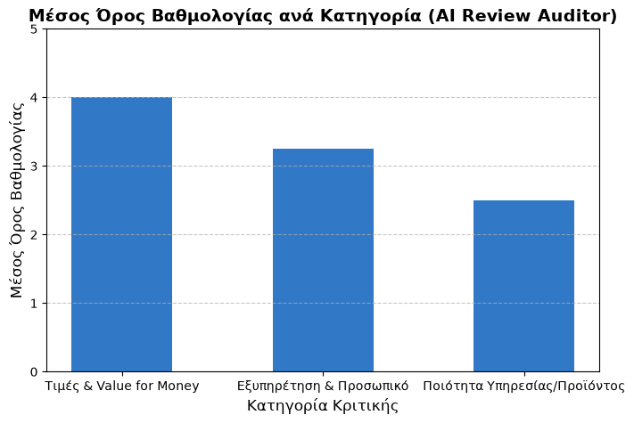

# AI Review Auditor

A small RAG (Retrieval-Augmented Generation) project that answers questions about customer reviews stored in PostgreSQL. I built it to learn how a RAG pipeline works end to end: from SQL, to embeddings and vector search, to an LLM answer that is based on real data.



## How it works

1. **Load data from PostgreSQL** – a `LEFT JOIN` between `reviews` and `categories` returns every review with its category (reviews without a category are kept).
2. **Build text documents** – each review becomes one LangChain `Document` with category, rating, comment, sentiment and suggestion.
3. **Create embeddings** – the multilingual model `paraphrase-multilingual-MiniLM-L12-v2` turns each review into a 384-dimensional vector (the reviews are in Greek).
4. **Store in ChromaDB** – vectors are kept in an in-memory Chroma collection.
5. **Retrieve** – for each question, the 3 most similar reviews are returned (`k=3`).
6. **Generate an answer** – the reviews and the question go into a prompt for an LLM on Groq (a Qwen model, `temperature=0`). The system prompt tells the model to use only these reviews and to say *"Δεν προκύπτει από τις καταχωρημένες κριτικές"* when the answer is not in the data.

The pipeline is written with LangChain Expression Language (LCEL):
`retriever → format_docs → prompt → LLM → StrOutputParser`.

`visualize.py` is a separate script: it computes the average rating per category with SQL (`JOIN`, `GROUP BY`, `AVG`) and saves the chart above with matplotlib.

## Tech stack

- Python, psycopg2
- PostgreSQL
- LangChain (LCEL), langchain-huggingface, langchain-community, langchain-groq
- ChromaDB
- Groq API
- matplotlib

## Run it locally

Developed on macOS with Python 3.14.

```bash
python3 -m venv venv
source venv/bin/activate
pip install -r requirements.txt
```

The database needs two tables with these columns:

- `reviews`: `author_name`, `rating` (1–5), `comment`, `sentiment`, `ai_suggestion`, `category_id`
- `categories`: `id`, `category_name`

Credentials are read from environment variables, never from the code:

```bash
export GROQ_API_KEY="your_groq_key"
export PGDATABASE="postgres"      # optional, default: postgres
export PGUSER="postgres"          # optional, default: postgres
# Password: use PGPASSWORD or a ~/.pgpass file
```

```bash
python app.py          # ask questions in the terminal, type "έξοδος" to exit
python visualize.py    # creates ratings_chart.png
```

Example question: `Τι παράπονα υπάρχουν για την ποιότητα;`

## Limitations

- The LLM only sees the 3 most relevant reviews, so it is not suitable for counting or averages. Those questions are better answered with SQL (as in `visualize.py`).
- The vector store is in memory, so embeddings are rebuilt every time `app.py` starts.
- Chroma uses its default distance metric (L2).
- The system prompt and `temperature=0` reduce made-up answers, but they cannot fully prevent them.
- Groq model names change over time; `model_name` in `app.py` may need updating.
- Tested with a small sample dataset.

## What I learned

- Writing SQL joins and aggregations and reading the results in Python
- How embeddings and vector similarity search work
- Building a RAG chain with LangChain LCEL
- Keeping API keys and passwords out of the code

## Next steps

- Save the Chroma collection to disk (`persist_directory`)
- Add category and rating as metadata, to filter results
- Show which reviews were used for each answer
- Add a small set of test questions to check answer quality

See [CHANGELOG.md](CHANGELOG.md) for the problems I ran into and how I solved them.

---

# AI Review Auditor (Ελληνικά)

Ένα μικρό project RAG (Retrieval-Augmented Generation) που απαντά σε ερωτήσεις για κριτικές πελατών αποθηκευμένες σε PostgreSQL. Το έφτιαξα για να μάθω πώς δουλεύει ένα σύστημα RAG από την αρχή ως το τέλος: από την SQL, στα embeddings και την αναζήτηση με διανύσματα, ως μια απάντηση LLM που βασίζεται σε πραγματικά δεδομένα.

## Πώς δουλεύει

1. **Φόρτωση από PostgreSQL**: `LEFT JOIN` των `reviews` με `categories`, ώστε να έρθει κάθε κριτική με την κατηγορία της (κρατιούνται και όσες δεν έχουν κατηγορία).
2. **Κείμενα**: κάθε κριτική γίνεται ένα `Document` με κατηγορία, βαθμολογία, σχόλιο, συναίσθημα και πρόταση.
3. **Embeddings**: το πολύγλωσσο μοντέλο `paraphrase-multilingual-MiniLM-L12-v2` μετατρέπει κάθε κριτική σε διάνυσμα 384 διαστάσεων.
4. **ChromaDB**: τα διανύσματα αποθηκεύονται σε Chroma στη μνήμη.
5. **Αναζήτηση**: για κάθε ερώτηση επιστρέφονται οι 3 πιο σχετικές κριτικές.
6. **Απάντηση**: κριτικές και ερώτηση μπαίνουν σε prompt για ένα LLM στο Groq (μοντέλο Qwen, `temperature=0`), με οδηγία να απαντά μόνο από αυτές.

Το `visualize.py` υπολογίζει με SQL τον μέσο όρο βαθμολογίας ανά κατηγορία και φτιάχνει το γράφημα με matplotlib.

## Περιορισμοί

- Το LLM βλέπει μόνο 3 κριτικές, άρα δεν είναι κατάλληλο για μετρήσεις και μέσους όρους· αυτά γίνονται με SQL.
- Τα embeddings ξαναφτιάχνονται σε κάθε εκκίνηση.
- Το prompt και το `temperature=0` μειώνουν τις επινοημένες απαντήσεις, αλλά δεν τις αποκλείουν.
- Δοκιμάστηκε με μικρό δείγμα δεδομένων.

Οδηγίες εγκατάστασης και εκτέλεσης: δες την αγγλική ενότητα παραπάνω.
